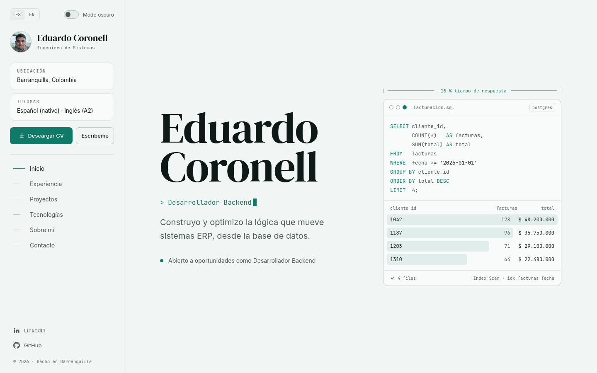

<div align="center">

# Eduardo Coronell · Portafolio

Portafolio personal de **Eduardo Coronell**, Desarrollador Backend en Barranquilla, Colombia.<br>
Sitio estático y bilingüe, hecho con Astro y desplegado en Vercel.

**[eduardocoronell.vercel.app](https://eduardocoronell.vercel.app)**


</div>

<picture>
  <source media="(prefers-color-scheme: dark)" srcset="docs/preview-dark.png">
  
</picture>

## Características

- **Bilingüe:** español en `/` e inglés en `/en/`, con `hreflang` y un sitemap que enlaza ambas versiones.
- **Tema claro y oscuro:** sigue la preferencia del sistema y recuerda la elección del visitante.
- **Imágenes generadas en el build:** la vista previa para redes (`/og/es.png`, `/og/en.png`), el favicon y el ícono de iOS se dibujan con [satori](https://github.com/vercel/satori); no hay imágenes que editar a mano.
- **SEO completo:** URL canónica, Open Graph y datos estructurados `Person` (JSON-LD).
- **Contenido validado:** proyectos y experiencia viven en archivos JSON que Astro valida con Zod; un campo que falta o una fecha mal escrita rompen el build en lugar de llegar a producción.
- **Accesible:** enlace para saltar al contenido, foco visible al navegar con teclado, menú móvil que se cierra con <kbd>Esc</kbd> y animaciones que respetan `prefers-reduced-motion`.
- **Ligero:** sin frameworks en el cliente; todo el comportamiento cabe en un solo script (`src/scripts/site.ts`).

## Empezar

Requisitos: **Node 22.12** o superior y **[pnpm](https://pnpm.io)** (`npm install -g pnpm`).

```bash
git clone git@github.com:EduardoNovato/portafolio.git
cd portafolio
pnpm install
pnpm dev
```

El sitio queda en <http://localhost:4321>.

| Comando | Qué hace |
| --- | --- |
| `pnpm dev` | Servidor de desarrollo con recarga en vivo |
| `pnpm build` | Genera el sitio estático en `dist/` |
| `pnpm preview` | Sirve `dist/` localmente para revisarlo antes de publicar |
| `pnpm check` | Revisa tipos y plantillas de Astro |

## Estructura

```text
src/
├── components/      Secciones de la página (Hero, Experience, Projects…)
├── content/
│   ├── experience/  Un .json por trabajo
│   └── projects/    Un .json por proyecto
├── data/site.ts     Datos de contacto y tecnologías del carrusel
├── i18n/ui.ts       Todos los textos en español e inglés
├── layouts/         Plantilla HTML base: SEO, tema y analítica
├── lib/             Generación de imágenes con satori
├── pages/           Rutas: /, /en/, 404, imágenes OG y favicon
├── scripts/site.ts  Interacción: tema, menú móvil, animaciones
└── styles/          Colores y tipografía (global.css)
public/
└── cv/              CV descargable
```

## Actualizar el contenido

| Qué | Dónde |
| --- | --- |
| Proyectos | Un `.json` por proyecto en `src/content/projects/`; el campo `order` define la posición |
| Experiencia | Un `.json` por trabajo en `src/content/experience/`; las cifras entre `**dobles asteriscos**` se resaltan |
| Textos en ambos idiomas | `src/i18n/ui.ts` |
| Correo, links y tecnologías del carrusel | `src/data/site.ts` |
| Colores y tipografía | Variables al inicio de `src/styles/global.css` |
| CV descargable | `public/cv/eduardo-coronell-cv.pdf` |

### Agregar un proyecto

Crea un archivo nuevo en `src/content/projects/`, por ejemplo `mi-proyecto.json`:

```json
{
  "title": "Mi proyecto",
  "order": 5,
  "year": 2026,
  "art": "cli",
  "kind": { "es": "Herramienta de línea de comandos · Go", "en": "Command-line tool · Go" },
  "description": {
    "es": "Qué hace y qué problema resuelve, en una o dos frases.",
    "en": "What it does and which problem it solves, in one or two sentences."
  },
  "stack": ["Go", "SQLite"],
  "repo": "https://github.com/EduardoNovato/mi-proyecto",
  "demo": "https://mi-proyecto.vercel.app"
}
```

`demo` es opcional. `art` elige la ilustración de la tarjeta entre las que ya existen
(`erp`, `cli`, `nonet`, `music`). Para una ilustración nueva, dibújala en
`src/components/ProjectArt.astro` y agrega su clave al `enum` de `art` en `src/content.config.ts`.

> [!IMPORTANT]
> El teléfono no se publica en ninguna parte del sitio. Exporta el CV **sin teléfono** antes de
> reemplazar `public/cv/eduardo-coronell-cv.pdf`.

## Despliegue

Vercel detecta Astro y pnpm automáticamente: importa el repositorio y no hace falta configurar nada.
Cada push a `main` publica una versión nueva.

Para ver las visitas, activa **Web Analytics** en el panel del proyecto en Vercel; el script ya está incluido.

## Licencia

El código está bajo la [licencia MIT](LICENSE): puedes usarlo como base para tu propio portafolio.

El contenido personal **no** está incluido en esa licencia: la foto, el CV, los textos sobre mi experiencia
y mis proyectos, y mis datos de contacto. Si reutilizas el sitio, reemplázalos por los tuyos.

## Contacto

[LinkedIn](https://www.linkedin.com/in/eduardo-coronell) · [GitHub](https://github.com/EduardoNovato) · [ejco2003@gmail.com](mailto:ejco2003@gmail.com)
